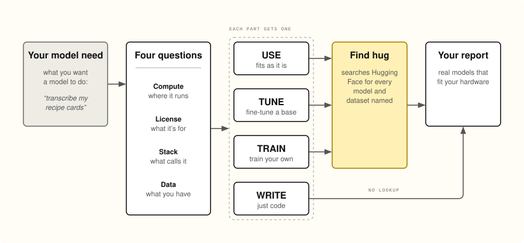

<p align="center">
  <picture>
    <source media="(prefers-color-scheme: dark)" srcset=".github/logo-dark.svg">
    
  </picture>
</p>

<h1 align="center">Where's My Hug?</h1>

<p align="center">
  <a href="https://www.npmjs.com/package/wheres-my-hug"></a>
  <a href="https://github.com/bikemeardsley/wheres-my-hug/actions/workflows/test.yml"></a>
  <a href="https://modelcontextprotocol.io"></a>
  <a href="https://skills.sh/bikemeardsley/wheres-my-hug/wheres-my-hug"></a>
  <a href="https://huggingface.co/models"></a>
  <br>
  <a href="#development"></a>
  <a href="#install"></a>
  <a href="LICENSE"></a>
  <a href="https://buymeacoffee.com/bikemeardsley"></a>
  <a href="https://www.als.net/donate/"></a>
</p>

Tell your AI agent what you want a model to do. It tells you which parts
Hugging Face already has, which to fine-tune, which to train, and which are
just code, and every model it names is real, current, and sized for your
hardware.

Works with Claude Code, Codex, Copilot, Cursor, Gemini CLI, Cline, Devin, Open
WebUI and any other MCP client, or as an Agent Skill.

<p align="center">
  <picture>
    <source media="(prefers-color-scheme: dark)" srcset=".github/flow-dark.svg">
    
  </picture>
</p>

## Try it

Add it to your agent (Claude Code here; [every other option](#install) below):

```sh
claude mcp add --scope user wheres-my-hug -- npx -y wheres-my-hug
```

Then ask:

> **Where's my hug at for transcribing handwritten recipe cards?**

Your agent asks the few things it can't guess, splits the job into parts, and
comes back with a report like the [one below](#example-recipe-cards), every
model and dataset in it looked up on Hugging Face moments before. It works for
any job a model might do:

> Where's my hug at for spotting which birds visit my feeder camera?<br>
> Where's my hug at for sorting support emails by how urgent they are?<br>
> Where's my hug at for pulling the totals off scanned receipts?

## How it works

### 1. Four questions first

Ask for "a model that reads handwriting" and you get whatever is popular:
often too big for your GPU, under a license you can't ship, or in a format
your code can't load. So before anything is named, four details come first.
Your agent fills in what the conversation or your codebase already says, and
asks you the rest:

| | What it asks | What that decides |
|---|---|---|
| **Compute** | Where will it run, and train if it needs to?<br>_one 24 GB GPU, CPU only, a phone, rented GPUs_ | How big a model can be, and whether fine-tuning is possible at all |
| **License** | What may the result be used for?<br>_commercial, open source, personal_ | Which licenses are allowed |
| **Stack** | What will call the model?<br>_a Python service, Node, the browser, a mobile app_ | Which weight formats work |
| **Data** | What training data is there, or could be?<br>_none, about 300 labeled photos, can collect more_ | Whether fine-tuning or training is realistic |

"Not sure yet" is a fine answer: the picks then cover the range, and every
model shows the memory it needs, so the report helps you decide.

### 2. Split the job, decide each part

The agent breaks the need into parts, each with an input and an output
(photo → text, text → fields), and gives each one a verdict:

| Verdict | Meaning |
|---|---|
| **USE** | A model on Hugging Face does this job as it is. |
| **TUNE** | A model on Hugging Face comes close: fine-tune it, ideally on a named dataset. |
| **TRAIN** | Nothing on Hugging Face comes close: train a model, seeded by named datasets. |
| **WRITE** | Not a model's job (rules, geometry, parsing, lookups): write the code. |

Most needs have a WRITE part. A model doing work that code does exactly is a
cost, not a feature.

### 3. Check every name on Hugging Face

The agent names exact models and datasets, and every one is looked up on
Hugging Face, live. Any that don't exist are dropped, and the agent is sent
back for others. The rest are flagged for what would bite later and sized
against your compute, and that report is what you see. The agent decides what
fits and in what order; every fact in the report (license, size, downloads,
freshness) comes from Hugging Face.

Under the hood it's an MCP server with two tools: `wheres_my_hug` for steps 1
and 2, and `wheres_my_hug_verify` for step 3.

### Flags

| Flag | When |
|---|---|
| UNCHECKED | Hugging Face didn't answer (down, rate-limited). The id is kept, and asked again next time. |
| GATED | You must accept its terms on Hugging Face before downloading. |
| NO_LICENSE | No license on its card. |
| NON_COMMERCIAL | Non-commercial or research-only terms (`cc-by-nc-*`, `*-research`, …). |
| OWN_TERMS | Custom, use-restricted or no-derivatives terms (`other`, Llama, Gemma, RAIL, `-nd-`). Can come with NON_COMMERCIAL: `cc-by-nc-nd` is both. |
| STALE | Not updated in two years. |
| LITTLE_USED | Under 100 downloads in the last month. |

### Sizes: what runs here, and what might do better

Every model shows the memory it needs to run: 2.4 bytes per parameter, half
precision plus room for activations. A model to fine-tune also shows what that
takes: about 1 byte per parameter with QLoRA, 16 in full. Against the compute
you gave (its first "N GB"):

- The first model that **fits** heads its part.
- Bigger ones follow under "If you can make it work", in the agent's order.
  **A stretch** fits only quantized to 4 bits (0.6 bytes per parameter), or
  on a bigger GPU. **Cloud** needs more than that: the report names the
  providers serving it on Hugging Face, or says rented GPUs.
- A part where nothing fits still shows its bigger options. It isn't sent
  back for replacements, since the hardware might be found.

A model named as a dataset (or the other way round) is found under the right
kind. Licenses come from the card's metadata: `license`, `license_name` for
custom terms (reported as `other (qwen-research)`), or a `license:` tag.

## Example: recipe cards

The prompt above, from a live run on one 24 GB GPU (abridged):

```
## USE  ·  Read the card
**Model: Qwen/Qwen2.5-VL-7B-Instruct**
license apache-2.0 · 8.3B parameters (~19.9 GB to run) · 5.4M downloads a month
If you can make it work, bigger than one 24 GB GPU:
- Qwen/Qwen2.5-VL-32B-Instruct: a stretch: ~80.3 GB to run, ~20.1 GB quantized to 4 bits, hosted by featherless-ai
- Qwen/Qwen2.5-VL-72B-Instruct: cloud: ~176.2 GB to run, hosted by featherless-ai, ovhcloud (own terms)

## TUNE  ·  Read the hard hands
**Model: Qwen/Qwen2.5-VL-3B-Instruct**
license other (qwen-research) · 3.8B parameters (~9.0 GB to run; to fine-tune, ~3.8 GB with QLoRA, ~60.1 GB in full)
Watch out: non-commercial or research-only terms; its own terms (custom, use-restricted or no-derivatives): read them.
**Data: Teklia/IAM-line**
license mit · 3.9k downloads a month · updated 3 years ago
Also: microsoft/trocr-large-handwritten (no license, stale)

## WRITE  ·  Parse the amounts
No model: write this one.
```

## Install

Needs Node 22.18 or later. Pick what your agent uses.

**Claude Code, Codex, Copilot CLI**, as a plugin: the tools, plus a skill that
knows when to reach for them. One marketplace serves all three.

```sh
/plugin marketplace add bikemeardsley/wheres-my-hug          # Claude Code
/plugin install wheres-my-hug@wheres-my-hug

codex plugin marketplace add bikemeardsley/wheres-my-hug      # Codex
codex plugin add wheres-my-hug@wheres-my-hug

copilot plugin marketplace add bikemeardsley/wheres-my-hug    # Copilot CLI
copilot plugin install wheres-my-hug@wheres-my-hug
```

Devin's CLI reads the same plugin: `devin plugins install bikemeardsley/wheres-my-hug`.

**Any other MCP client** (Claude Desktop, Cursor, Windsurf, Cline, Goose,
Kiro, Junie, LM Studio, Warp, …): a stdio server, in the client's config.
Most call the key `mcpServers`; VS Code calls it `servers`, Zed
`context_servers`, OpenCode `mcp`.

```json
{ "mcpServers": { "wheres-my-hug": { "command": "npx", "args": ["-y", "wheres-my-hug"] } } }
```

`npx` checks for the latest version each time it starts, which takes a few
seconds. If a client gives up waiting, give it longer (Claude Code reads
`MCP_TIMEOUT` from the environment; Codex reads `startup_timeout_sec`, which
the plugin sets), or install it once with `npm install -g wheres-my-hug` and
use `wheres-my-hug` as the command, which starts at once.

**Gemini CLI**, as an extension: `gemini extensions install https://github.com/bikemeardsley/wheres-my-hug`

**Open WebUI**, and other clients that speak MCP over HTTP only: run it as an
HTTP server, then add `http://<host>:8000/mcp` in Open WebUI's admin settings
as an external tool server of type MCP (Streamable HTTP).

```sh
npx -y wheres-my-hug --http 0.0.0.0:8000
```

Without a host it listens on 127.0.0.1 only. Anyone who can reach the port can
use it, including, with `HF_TOKEN` set, looking up private repos the token can
see: keep it on a network you trust.

**As an Agent Skill**, for agents that read `SKILL.md` (Cline, Cursor,
Copilot, Goose, OpenCode, Amp, Zed, Junie, Hermes, Mistral Vibe and more):
`npx skills add bikemeardsley/wheres-my-hug`. The skill uses the MCP tools
when they're connected, and otherwise runs the same two steps from a shell:

```sh
npx -y wheres-my-hug rubric < details.json
npx -y wheres-my-hug verify < slate.json
```

**`HF_TOKEN` (optional).** Everything public works without one. To include
private repos your account can see, set `HF_TOKEN` in the environment the
agent starts from, or add `-e HF_TOKEN=hf_…` to the `claude mcp add` line.
Without a token, a private repo looks missing, because Hugging Face answers
401 for both.

## What leaves your machine

Only the ids, as GETs to `huggingface.co/api`, plus your token if you set one.
The token is sent only there and never appears in a report. The need, the
method and the report stay between you and your agent.

## Limits

- Sizes come from `safetensors` metadata. Repos with only GGUF or `.bin`
  weights show no parameter count, so they can't be sized against the
  compute.
- License flags read the card's metadata, not the license text.

## Security

Report a vulnerability privately through
[GitHub Security Advisories](https://github.com/bikemeardsley/wheres-my-hug/security/advisories/new),
not a public issue. [SECURITY.md](SECURITY.md) lists what it touches: GETs to
Hugging Face, and nothing on your machine.

## Development

```sh
node src/server.ts   # the server, straight from source
npm test             # offline: Hugging Face is mocked, and the server is driven over stdio and HTTP
npm run check        # types
```

`npm install` also builds JavaScript into `build/`, which is what `npx` runs:
Node won't strip types from a package inside `node_modules`.

## Credits

Inspired by [kitbash](https://github.com/Open-Dev-Society/kitbash), which does
the same for GitHub repos: a method the agent follows, then a check that owns
the report. No code or text is shared.

## License

MIT
